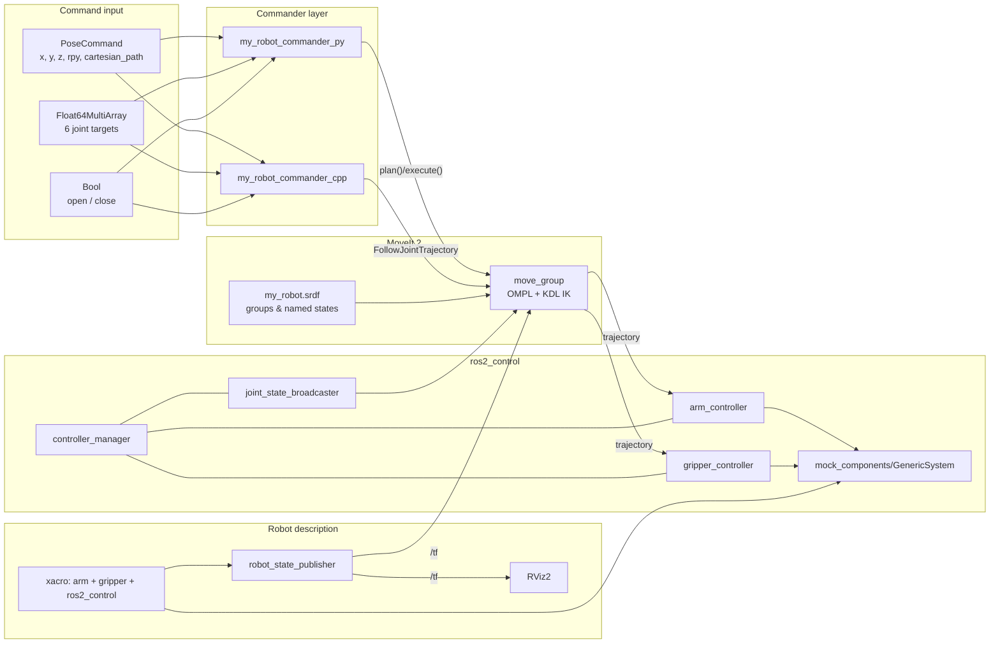

# project_GMT — ROS 2 + MoveIt 2 robot arm stack

[](https://github.com/Saadest/project_GMT/actions/workflows/ci.yml)
[](https://docs.ros.org/en/jazzy/)
[](https://moveit.picknik.ai/)
[](my_robot_commander_cpp)
[](my_robot_commander_py)
[](LICENSE)

A complete, buildable ROS 2 workspace for a **6-DoF revolute arm with a parallel
gripper**, planned with **MoveIt 2** and driven through a simulated
`ros2_control` backend. The stack covers the full path from robot description to
motion execution: URDF/xacro model → `ros2_control` hardware interface → joint
trajectory controllers → MoveIt 2 planning pipeline → high-level commander nodes
in both Python and C++.

---

## Highlights

- **One-command bringup** — `ros2 launch my_robot_bringup my_robot.launch.xml`
  starts the robot state publisher, the ros2_control node, all controllers,
  `move_group` and RViz2 pre-loaded with the planning layout.
- **Model-first** — the description is modular xacro (`arm`, `gripper`,
  `ros2_control`, shared properties) so geometry and control can be swapped
  independently.
- **Two commander front-ends** — a Python node built on `moveit_py` and a C++
  node built on `MoveGroupInterface`, exposing the same three command topics.
- **Planning-ready** — SRDF with `arm` / `gripper` groups, named states
  (`home`, `pose_1`, `pose_2`, `gripper_open`, `gripper_closed`,
  `gripper_half_closed`), KDL IK and the OMPL pipeline configured.
- **Engineered for collaboration** — CI (colcon build + test), issue/PR
  templates, `pre-commit` hooks, editor config and semantic, scoped commits.

---

## Architecture



**TF tree of the model**

```
world ──(virtual_joint, fixed)── base_link
  └── joint1 ── shoulder_link ── joint2 ── arm_link ── joint3 ── elbow_link
        └── joint4 ── forearm_link ── joint5 ── wrist_link ── joint6 ── hand_link
              └── hand_tool_joint ── tool_link ── gripper_base_joint ── gripper_base_link
                    ├── gripper_left_finger_joint  ── gripper_left_finger_link
                    └── gripper_right_finger_joint ── gripper_right_finger_link
```

Deeper design notes: [`docs/architecture.md`](docs/architecture.md).

---

## Packages

| Package | Build type | Role |
| --- | --- | --- |
| [`my_robot_interfaces`](my_robot_interfaces) | `ament_cmake` (rosidl) | Custom `PoseCommand` message used by both commanders. |
| [`my_robot_description`](my_robot_description) | `ament_cmake` | xacro model of the arm and gripper, RViz2 display launch and view config. |
| [`my_robot_moveit_config`](my_robot_moveit_config) | `ament_cmake` | MoveIt 2 configuration from the Setup Assistant: SRDF, limits, kinematics, controllers, RViz layout. |
| [`my_robot_bringup`](my_robot_bringup) | `ament_cmake` | Top-level launch file and `ros2_control` controller configuration. |
| [`my_robot_commander_py`](my_robot_commander_py) | `ament_python` | MoveIt 2 commander node in Python (`moveit_py`). |
| [`my_robot_commander_cpp`](my_robot_commander_cpp) | `ament_cmake` | Commander node and a bare-metal `test_moveit` probe in C++. |

Robot at a glance: 6 revolute/continuous arm joints (`joint1`…`joint6`, ±3.14 rad
on the base and wrist roll, 0…2.5 rad on the shoulder/elbow pitch joints), one
actuated gripper joint, collision geometry on every link. Full joint table in
[`docs/packages.md`](docs/packages.md).

---

## Quick start

### Prerequisites

- Ubuntu 24.04 with **ROS 2 Jazzy** (`ros-jazzy-desktop`)
- MoveIt 2: `sudo apt install ros-jazzy-moveit ros-jazzy-moveit-py`
- Build tools: `python3-colcon-common-extensions python3-rosdep`

### Build

```bash
mkdir -p ~/ros2_ws/src && cd ~/ros2_ws/src
git clone https://github.com/Saadest/project_GMT.git

cd ~/ros2_ws
sudo rosdep init 2>/dev/null || true
rosdep update
rosdep install --from-paths src --ignore-src -r -y
colcon build --symlink-install
source install/setup.bash
```

### Visualize the model only

```bash
ros2 launch my_robot_description display.launch.xml
```

### Full stack (description + controllers + MoveIt + RViz)

```bash
ros2 launch my_robot_bringup my_robot.launch.xml
```

### MoveIt 2 demo (planning without the bringup)

```bash
ros2 launch my_robot_moveit_config demo.launch.py
```

### Drive the robot from the commander

```bash
# Python commander (moveit_py)
ros2 run my_robot_commander_py commander

# C++ commander (MoveGroupInterface)
ros2 run my_robot_commander_cpp commander
```

Then publish commands from a second terminal:

```bash
# Named target is not exposed on a topic; use joint or pose commands:
ros2 topic pub --once /joint_command example_interfaces/msg/Float64MultiArray \
  "{data: [0.0, 0.5, -0.5, 0.0, 0.5, 0.0]}"

ros2 topic pub --once /pose_command my_robot_interfaces/msg/PoseCommand \
  "{x: 0.30, y: 0.0, z: 0.35, roll: 0.0, pitch: 1.57, yaw: 0.0, cartesian_path: false}"

ros2 topic pub --once /open_gripper example_interfaces/msg/Bool "{data: true}"
```

Command reference: [`docs/interfaces.md`](docs/interfaces.md) ·
Build and troubleshooting: [`docs/build-and-run.md`](docs/build-and-run.md).

---

## Repository layout

```
project_GMT/
├── my_robot_interfaces/          # custom messages
├── my_robot_description/         # xacro model, rviz config, display launch
├── my_robot_moveit_config/       # MoveIt 2 configuration + py launch files
├── my_robot_bringup/             # system launch + ros2_control controllers
├── my_robot_commander_py/        # Python commander node (+ ament lint tests)
├── my_robot_commander_cpp/       # C++ commander node + MoveIt probe
├── docs/                         # architecture, interfaces, build, packages
├── .github/                      # CI workflow, issue & PR templates
├── CHANGELOG.md
├── CONTRIBUTING.md
└── LICENSE
```

---

## Documentation

| Document | Contents |
| --- | --- |
| [`docs/architecture.md`](docs/architecture.md) | Node graph, data flow, control chain, design decisions. |
| [`docs/build-and-run.md`](docs/build-and-run.md) | Environment setup, build, run recipes, troubleshooting. |
| [`docs/packages.md`](docs/packages.md) | Per-package reference, joint table, file map. |
| [`docs/interfaces.md`](docs/interfaces.md) | Topics, message types and named planning states. |
| [`docs/publishing.md`](docs/publishing.md) | How this repository is published and versioned. |

---

## Status and known limitations

This stack targets simulation with `mock_components/GenericSystem` and has not
yet been validated on physical hardware. Current gaps, tracked in
[`CHANGELOG.md`](CHANGELOG.md):

- `my_robot_commander_py`'s `package.xml` declares only `rclpy`; running it also
  requires `moveit_py`, `moveit_configs_utils`, `tf_transformations`,
  `example_interfaces` and `my_robot_interfaces` (install them or add them as
  `exec_depends`).
- Most `package.xml` files still carry the generator's placeholder description
  and maintainer fields.
- The ament lint suite reports 144 flake8 findings in
  `commander_template.py` / `test_moveit.py` (quote style, import order, line
  length). CI therefore runs `colcon test` and `pre-commit` as **advisory**
  jobs: the `colcon build` step is the blocking gate.

---

## Contributing

Contributions are welcome — please read [`CONTRIBUTING.md`](CONTRIBUTING.md)
first. Commits follow the Conventional Commits specification and PRs are
squash-merged.

## License

Released under the [BSD 3-Clause License](LICENSE).
